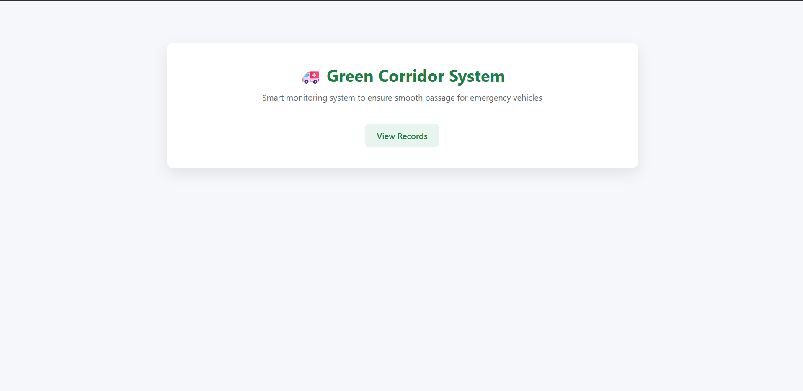
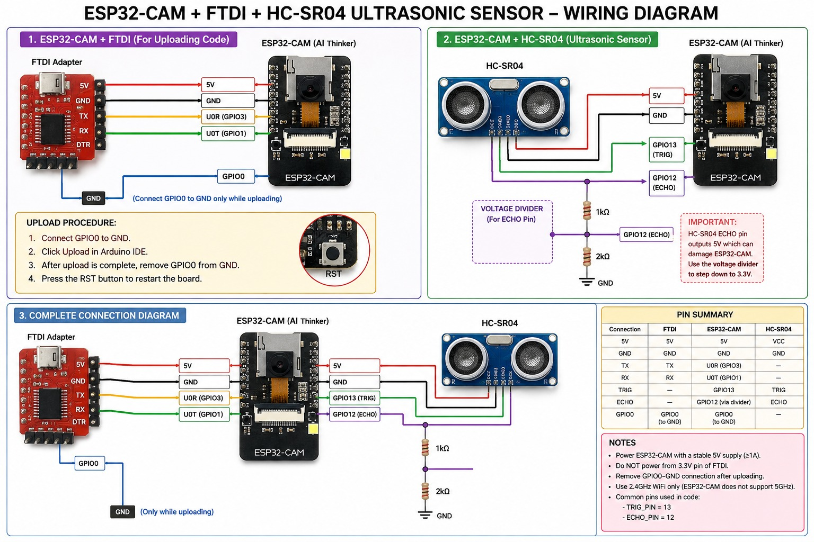
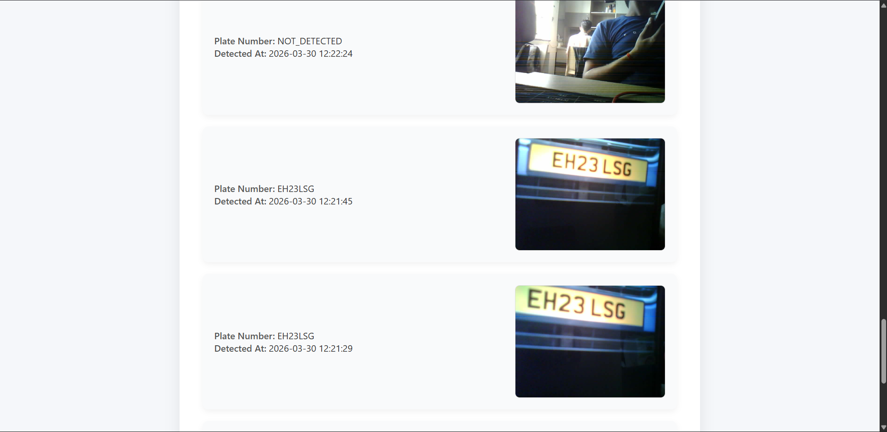

# 🚑 Green Corridor System

<p align="center">
  
</p>

<h3 align="center">
An AI-Powered IoT Vehicle Monitoring & Automatic Number Plate Recognition System
</h3>

<p align="center">


</p>

---

## 📖 About the Project

The **Green Corridor System** is an IoT and Artificial Intelligence based Automatic Number Plate Recognition (ANPR) project that combines embedded hardware, computer vision and web technologies to automate vehicle monitoring.

The system continuously monitors its surroundings using an **HC-SR04 Ultrasonic Sensor** connected to an **ESP32-CAM**. Whenever a vehicle enters the configured detection range, the ESP32-CAM captures an image and sends it to a Flask server over Wi-Fi.

The Flask backend processes the image using **OpenCV** and **EasyOCR** to identify vehicle registration numbers.

Whenever a valid number plate is detected, the system automatically:

- Extracts the registration number
- Stores the captured image
- Records the detection timestamp
- Saves the information inside a MySQL database
- Displays the detection through a web dashboard

This project demonstrates the integration of:

- Internet of Things (IoT)
- Embedded Systems
- Artificial Intelligence
- Computer Vision
- Optical Character Recognition (OCR)
- Database Management
- Full Stack Web Development

---

# 🎯 Objectives

The primary objective of the Green Corridor System is to automate vehicle monitoring using low-cost IoT hardware and Artificial Intelligence.

The project aims to:

- Detect approaching vehicles automatically.
- Capture images without manual intervention.
- Recognize vehicle registration numbers.
- Maintain a database of detected vehicles.
- Display captured records through a web application.
- Demonstrate communication between embedded hardware and a backend server.
- Build a modular project that can be extended in future.

---

# ✨ Features

- 📷 Automatic image capture
- 📏 Ultrasonic sensor-based triggering
- 🌐 Wi-Fi image transmission
- 🤖 AI-powered number plate recognition
- 🔍 OCR using EasyOCR
- 🖼 OpenCV image preprocessing
- 💾 MySQL database integration
- 📅 Timestamp logging
- 🌐 Flask web application
- 📱 Responsive web interface
- 📂 Automatic image storage
- 📋 Detection history dashboard
- ⚡ Modular architecture
- 🚀 Lightweight implementation

---

# 💻 Technology Stack

| Category | Technology |
|-----------|------------|
| Programming Language | Python, C++ |
| Backend | Flask |
| Computer Vision | OpenCV |
| OCR | EasyOCR |
| Database | MySQL |
| Embedded Device | ESP32-CAM |
| Sensor | HC-SR04 Ultrasonic Sensor |
| Frontend | HTML, CSS |
| IDE | Arduino IDE, Visual Studio Code |

---

# 📚 Libraries Used

## Python

- Flask
- OpenCV
- EasyOCR
- MySQL Connector
- NumPy
- Requests

## Arduino

- WiFi
- WebServer
- esp_camera
- ESP32 Board Libraries

---

# 📌 Why this Project?

Modern traffic systems increasingly rely on automation for monitoring vehicles.

Instead of requiring continuous human supervision, the Green Corridor System automatically captures vehicle images, recognizes registration numbers and maintains a digital log.

The project demonstrates how inexpensive IoT hardware can be combined with Artificial Intelligence to build practical smart-city applications.

Potential applications include:

- Smart Parking
- Toll Booth Automation
- Residential Security
- University Entry Monitoring
- Industrial Gate Access
- Vehicle Logging Systems
- Emergency Traffic Management

---

# 👨‍💻 Developers

<table>
<tr>

<td align="center">

## Vaibhav Kumar

Project Developer

</td>

<td align="center">

## Abhinav Narayan

Project Developer

</td>

</tr>
</table>

---

# 🔧 Hardware Components

The Green Corridor System combines embedded hardware with Artificial Intelligence to automate vehicle detection and number plate recognition.

The hardware setup is intentionally lightweight, inexpensive, and easy to reproduce, making it suitable for academic projects, research, and smart city prototypes.

| Component | Description |
|-----------|-------------|
| **ESP32-CAM (AI Thinker)** | Captures vehicle images and communicates with the Flask server over Wi-Fi. |
| **HC-SR04 Ultrasonic Sensor** | Continuously measures distance and triggers image capture whenever a vehicle enters the configured threshold distance. |
| **FTDI Programmer** | Used to upload firmware to the ESP32-CAM. |
| **Voltage Divider** | Reduces the HC-SR04 Echo pin from 5V to 3.3V to safely interface with the ESP32-CAM. |
| **Breadboard & Jumper Wires** | Used for prototyping and connecting components. |
| **5V Power Supply** | Powers the ESP32-CAM and ultrasonic sensor during operation. |

---

# 📷 Hardware Setup

The ESP32-CAM serves as the central embedded device responsible for image acquisition.

Unlike traditional surveillance systems that continuously capture video, this project captures an image **only when a vehicle is detected**, reducing computational overhead and storage requirements.

The HC-SR04 ultrasonic sensor continuously measures the distance in front of the camera. Once the measured distance falls below the configured threshold, the ESP32-CAM captures an image and transmits it to the Flask server over Wi-Fi.

This event-driven architecture minimizes unnecessary image processing while improving overall system efficiency.

---

# 🔌 Hardware Wiring

The following wiring diagram illustrates the complete hardware connections used in the project.


<p align="center">

</p>

### Connection Summary

| ESP32-CAM Pin | Connected To |
|---------------|--------------|
| 5V | HC-SR04 VCC |
| GND | HC-SR04 GND |
| GPIO13 | HC-SR04 TRIG |
| GPIO12 | HC-SR04 ECHO (through voltage divider) |

---

## ⚠ Important Note

The **HC-SR04 Echo pin outputs a 5V signal**, whereas the ESP32-CAM GPIO pins are **3.3V tolerant**.

To prevent damage to the ESP32-CAM, a **voltage divider** is used between the Echo pin and GPIO12.

---

# 🧠 System Architecture

The Green Corridor System consists of two major subsystems:

- Embedded IoT Hardware
- AI-based Backend Server

The ESP32-CAM is responsible only for image acquisition, while the computationally intensive OCR operations are performed on the Flask server.

```text
                 Vehicle
                    │
                    ▼
         HC-SR04 Ultrasonic Sensor
                    │
        Vehicle within Threshold?
                    │
                   Yes
                    │
                    ▼
              ESP32-CAM
           Capture Vehicle Image
                    │
             Wi-Fi Transmission
                    │
                    ▼
            Flask Web Server
                    │
                    ▼
        OpenCV Image Processing
                    │
                    ▼
          EasyOCR Text Detection
                    │
         Vehicle Number Extracted
                    │
                    ▼
             MySQL Database
                    │
                    ▼
          Flask Web Dashboard
```

---

# ⚙ Working Principle

The Green Corridor System follows a sequential workflow that combines sensing, image acquisition, Artificial Intelligence, and web technologies.

---

## Step 1 — Distance Measurement

The HC-SR04 ultrasonic sensor continuously emits ultrasonic pulses and measures the reflected signal.

The measured distance determines whether an object is present in front of the camera.

---

## Step 2 — Vehicle Detection

When the measured distance becomes smaller than the configured threshold value, the ESP32-CAM interprets this as a nearby vehicle.

This event triggers the image acquisition process.

---

## Step 3 — Image Capture

The ESP32-CAM captures a high-resolution image of the detected vehicle.

Unlike continuous video surveillance, only a single image is captured, reducing network bandwidth and processing time.

---

## Step 4 — Image Transmission

The captured image is sent over Wi-Fi to the Flask backend using an HTTP request.

The backend receives the image and stores it temporarily for processing.

---

## Step 5 — Image Preprocessing

The Flask server processes the image using OpenCV.

Typical preprocessing operations include:

- Noise reduction
- Grayscale conversion
- Contrast enhancement
- Image normalization

These operations improve OCR accuracy.

---

## Step 6 — Number Plate Recognition

The processed image is passed to EasyOCR.

EasyOCR scans the image and extracts all visible text.

The application then filters the OCR results to identify the most probable vehicle registration number.

---

## Step 7 — Database Storage

If a valid registration number is detected:

- Vehicle number is stored
- Timestamp is recorded
- Image path is saved
- Record becomes available on the website

If no valid number plate is found, the application stores **NOT_DETECTED**.

---

## Step 8 — Web Dashboard Update

The Flask application retrieves the latest detection records from MySQL and updates the web interface automatically.

Each record includes:

- Vehicle image
- Recognized plate number
- Date
- Time

---

# 📈 Advantages of the Architecture

The proposed architecture offers several advantages over continuous surveillance systems.

✅ Event-driven image capture

Only captures images when a vehicle is detected.

---

✅ Lower computational load

Since OCR is performed only when required, the server processes significantly fewer images.

---

✅ Reduced storage usage

Only meaningful images are stored instead of continuous video recordings.

---

✅ Modular software design

Each component (camera, OCR, database, and web application) is implemented as an independent module, making the system easier to maintain and extend.

---

✅ Easy scalability

Additional cameras or AI models can be integrated with minimal architectural changes.

---

# 💡 Design Decisions

Several design choices were made during development to improve performance and maintainability.

### Why ESP32-CAM?

- Low-cost hardware
- Built-in Wi-Fi
- Integrated OV2640 camera
- Compact form factor
- Easy Arduino IDE programming

---

### Why HC-SR04?

- Simple interface
- Accurate short-range distance measurement
- Reliable triggering mechanism
- Low power consumption

---

### Why Flask?

- Lightweight Python framework
- Easy integration with OpenCV
- Simple routing
- Excellent for rapid prototyping

---

### Why EasyOCR?

- No custom model training required
- Supports alphanumeric text recognition
- Easy integration with Python
- High accuracy for license plates

---

### Why MySQL?

- Reliable relational database
- Easy querying of detection records
- Supports large datasets
- Well suited for web applications

---

# 📂 Project Structure

The project follows a modular architecture where each component has a dedicated responsibility. This separation improves code readability, maintainability, and makes future feature additions much easier.

```text
green-corridor-system/
│
├── camera/
│   ├── __init__.py
│   └── camera.py
│
├── esp32-firmware/
│   └── esp32_cam.ino
│
├── database/
│   ├── __init__.py
│   └── db.py
│
├── ocr/
│   ├── __init__.py
│   └── plate_reader.py
│
├── static/
│   ├── css/
│   │   └── style.css
│   │
│   └── images/
│       ├── captures/
│       ├── homepage.png
│       ├── records-page.png
│       └── wiring-diagram.jpeg
│
├── templates/
│   ├── index.html
│   └── records.html
│
├── app.py
│
├── README.md
```

---

# 📦 Module Description

The project has been divided into multiple modules, each handling a specific responsibility.

---

## 📷 `camera/`

Responsible for communication with the ESP32-CAM and image acquisition.

### Responsibilities

- Receive images from the ESP32-CAM
- Save captured images
- Manage image handling before OCR

---

## 🤖 `ocr/`

Contains the complete Automatic Number Plate Recognition (ANPR) pipeline.

### Responsibilities

- Load captured images
- Perform image preprocessing using OpenCV
- Detect and extract vehicle registration numbers using EasyOCR
- Return recognized plate numbers to the application

---

## 🗄 `database/`

Handles all interactions with the MySQL database.

### Responsibilities

- Establish database connection
- Insert detection records
- Retrieve previous detections
- Execute SQL queries
- Manage database transactions

---

## 🎨 `static/`

Stores all static resources required by the web application.

### CSS

Contains website styling.

```
static/css/style.css
```

### Images

Contains images used throughout the project.

```
static/images/
```

#### captures/

This folder stores all images captured by the ESP32-CAM during runtime.

Example:

```
captures/
├── vehicle_001.jpg
├── vehicle_002.jpg
├── vehicle_003.jpg
```

These images are later processed by the OCR module.

---

## 🌐 `templates/`

Contains all HTML templates rendered by Flask.

Current pages include:

### index.html

Landing page of the Green Corridor System.

### records.html

Displays all captured vehicle detections.

---

## 🚀 `app.py`

The main entry point of the application.

Responsibilities include:

- Initializing the Flask application
- Registering routes
- Receiving uploaded images
- Invoking the OCR module
- Storing results in MySQL
- Rendering web pages

---

# 🗄 Database Design

The project uses **MySQL** to maintain a persistent record of all vehicle detections.

Each successful detection creates a new database entry.

## Database Schema

| Column | Type | Description |
|---------|------|-------------|
| id | INT | Unique record identifier |
| plate_number | VARCHAR(50) | Detected vehicle registration number |
| image_path | TEXT | Path of captured image |
| detected_at | DATETIME | Timestamp of detection |

---

## Example Record

| ID | Plate Number | Detection Time |
|----|--------------|----------------|
| 1 | MP04AB1234 | 2026-08-07 14:42:31 |

---

# 🚀 Installation

## 1. Clone the Repository

```bash
git clone https://github.com/YOUR_USERNAME/green-corridor-system.git
```

```bash
cd green-corridor-system
```

---

## 2. Create a Virtual Environment (Recommended)

### Windows

```bash
python -m venv venv
```

Activate

```bash
venv\Scripts\activate
```

### Linux/macOS

```bash
python3 -m venv venv
source venv/bin/activate
```

---

## 3. Install Dependencies

```bash
pip install -r requirements.txt
```

---

## 4. Configure MySQL

Create a new MySQL database.

Example:

```sql
CREATE DATABASE green_corridor;
```

Update the database credentials inside

```
database/db.py
```

with your MySQL username, password, and database name.

---

## 5. Upload ESP32-CAM Firmware

1. Connect the ESP32-CAM using an FTDI programmer.
2. Open the Arduino IDE.
3. Select **AI Thinker ESP32-CAM** as the target board.
4. Put the ESP32-CAM into programming mode.
5. Upload the firmware.
6. Restart the board after successful upload.

---

## 6. Start the Flask Server

Run

```bash
python app.py
```

The server will start at

```
http://127.0.0.1:5000
```

---

# ▶ Running the Project

Once everything has been configured, the system operates automatically.

### Step 1

Power the ESP32-CAM.

↓

### Step 2

Connect it to the configured Wi-Fi network.

↓

### Step 3

Launch the Flask application.

↓

### Step 4

Open the website.

↓

### Step 5

Place a vehicle within the ultrasonic sensor's detection range.

↓

### Step 6

The ESP32-CAM captures an image.

↓

### Step 7

The image is uploaded to the Flask server.

↓

### Step 8

OpenCV preprocesses the image.

↓

### Step 9

EasyOCR extracts the vehicle registration number.

↓

### Step 10

The captured image, recognized plate number, and timestamp are stored in the MySQL database.

↓

### Step 11

The web dashboard updates automatically with the latest detection.

---

# 🧠 OCR Processing Pipeline

The AI-based number plate recognition process follows the pipeline shown below.

```text
Vehicle Detection
        │
        ▼
ESP32-CAM Image Capture
        │
        ▼
HTTP Image Upload
        │
        ▼
Flask Backend
        │
        ▼
OpenCV Preprocessing
        │
        ▼
EasyOCR Recognition
        │
        ▼
Plate Validation
        │
        ▼
Database Storage
        │
        ▼
Website Update
```

---

## Image Preprocessing

Before OCR is performed, OpenCV prepares the image to improve recognition accuracy.

Typical preprocessing operations include:

- Image resizing
- Grayscale conversion
- Contrast enhancement
- Noise reduction
- Image normalization

---

## OCR Recognition

EasyOCR scans the processed image and returns:

- Detected text
- Confidence score
- Bounding box coordinates

The application filters the detected text to identify the most probable vehicle registration number.

---

## Result Validation

If a valid registration number is identified:

- Plate number is stored
- Image path is saved
- Timestamp is recorded

If no valid plate is found, the application stores **NOT_DETECTED**.

---

# 🌐 Website Overview

The Green Corridor System includes a lightweight web application built using **Flask** that serves as the user interface for viewing vehicle detection records.

Whenever the ESP32-CAM captures an image and the OCR pipeline successfully extracts a vehicle registration number, the information is automatically stored in the database and displayed on the web application.

The website provides a centralized interface for monitoring all detections and reviewing captured images.

---

# 🏠 Home Page

The home page introduces the Green Corridor System and serves as the main entry point to the application.

Features include:

- Clean and responsive interface
- Project overview
- Navigation to detection records
- Simple user experience

<p align="center">
    
</p>

---

# 📋 Detection Records

The Detection Records page displays every vehicle processed by the system.

Each record contains:

- 📷 Captured vehicle image
- 🚗 Recognized vehicle registration number
- 📅 Detection date
- 🕒 Detection time

If OCR cannot confidently identify a valid number plate, the system records **NOT_DETECTED**, allowing operators to review unsuccessful detections if required.

<p align="center">
    
</p>

---

# 📸 Image Storage

Every captured image is automatically stored inside

```text
static/images/captures/
```

This directory acts as the image repository for all detections.

Example:

```text
captures/
├── vehicle_001.jpg
├── vehicle_002.jpg
├── vehicle_003.jpg
├── vehicle_004.jpg
└── ...
```

The database stores the image path so that the website can display the corresponding image alongside each detection record.

---

# 🔄 Complete System Workflow

```text
Vehicle Approaches
        │
        ▼
HC-SR04 Detects Vehicle
        │
        ▼
ESP32-CAM Captures Image
        │
        ▼
Image Uploaded via Wi-Fi
        │
        ▼
Flask Backend
        │
        ▼
OpenCV Image Preprocessing
        │
        ▼
EasyOCR Number Plate Recognition
        │
        ▼
Plate Number Valid?
     │           │
    Yes          No
     │           │
     ▼           ▼
Store Record   Store as NOT_DETECTED
     │
     ▼
MySQL Database
     │
     ▼
Display on Website
```

---

# 🚦 Applications

The Green Corridor System demonstrates a practical implementation of IoT and AI that can be adapted to numerous real-world applications.

Potential applications include:

- 🚑 Emergency Green Corridor Monitoring
- 🚦 Smart Traffic Management
- 🚗 Automatic Number Plate Recognition (ANPR)
- 🅿 Smart Parking Systems
- 🏢 Office Vehicle Entry Management
- 🏫 University Campus Security
- 🏘 Residential Society Gate Automation
- 🏭 Industrial Access Control
- 🛣 Toll Booth Automation
- 🚔 Law Enforcement Vehicle Monitoring
- 📦 Logistics Vehicle Tracking
- 🛡 Security Surveillance Systems

---

# ⚠ Challenges Faced

Developing the Green Corridor System involved overcoming several technical challenges.

## ESP32-CAM Memory Limitations

The ESP32-CAM has limited RAM and processing power, making on-device OCR impractical.

**Solution**

Image processing was offloaded to a Flask server where more computational resources were available.

---

## OCR Accuracy

Vehicle number plates captured under poor lighting conditions or at extreme viewing angles reduced OCR accuracy.

**Solution**

OpenCV preprocessing techniques such as grayscale conversion, noise reduction, and contrast enhancement were used to improve recognition performance.

---

## Reliable Wi-Fi Communication

Stable communication between the ESP32-CAM and Flask server was essential.

**Solution**

Reliable HTTP communication and error handling mechanisms were implemented.

---

## Sensor Calibration

Selecting an appropriate trigger distance required experimentation.

A threshold that was too small missed approaching vehicles, while a threshold that was too large generated unnecessary image captures.

---

## Hardware Safety

The HC-SR04 Echo pin outputs 5V while the ESP32-CAM GPIO pins are rated for 3.3V.

**Solution**

A voltage divider was used to safely interface the ultrasonic sensor with the ESP32-CAM.

---

# 🚀 Future Enhancements

The current implementation serves as a strong proof of concept. Future versions may include:

- YOLOv8-based number plate localization
- Real-time video stream processing
- Multiple ESP32-CAM support
- Automatic ambulance detection
- Traffic signal integration
- GPS location tagging
- Cloud database deployment
- Mobile application
- Detection analytics dashboard
- REST API for external integration
- Email notifications
- Telegram alerts
- SMS notifications
- User authentication and role management
- Docker containerization
- AI-based vehicle classification
- TensorFlow Lite optimization
- Higher accuracy OCR models

---

# 📚 Learning Outcomes

This project provided practical experience in several domains, including:

- Internet of Things (IoT)
- Embedded Systems
- ESP32 Programming
- Sensor Integration
- Computer Vision
- Optical Character Recognition (OCR)
- Artificial Intelligence
- Flask Web Development
- MySQL Database Management
- RESTful Communication
- Modular Software Design
- Version Control with Git & GitHub

---

# 🤝 Contributors

| Name | Role |
|------|------|
| **Vaibhav Kumar** | Project Developer |
| **Abhinav Narayan** | Project Developer |

---

# 📜 License

This project was developed for **academic and educational purposes**.

You are welcome to use, modify, and extend this project for learning and research. Attribution is appreciated when using significant portions of the work.

---

# 🙏 Acknowledgements

We would like to thank the developers and maintainers of the following open-source technologies that made this project possible:

- Python
- Flask
- OpenCV
- EasyOCR
- MySQL
- ESP32 Arduino Core
- Arduino IDE

We also acknowledge the open-source community for providing excellent documentation, libraries, and resources that greatly assisted the development of this project.

---

# ⭐ Support

If you found this project interesting or useful, consider giving the repository a **⭐ Star** on GitHub.

Your support helps others discover the project and encourages future improvements.

---

<p align="center">

## 🚑 Green Corridor System

**Developed by Vaibhav & Abhinav Narayan**

*Combining IoT, Artificial Intelligence, and Computer Vision for Smarter Vehicle Monitoring.*

</p>
